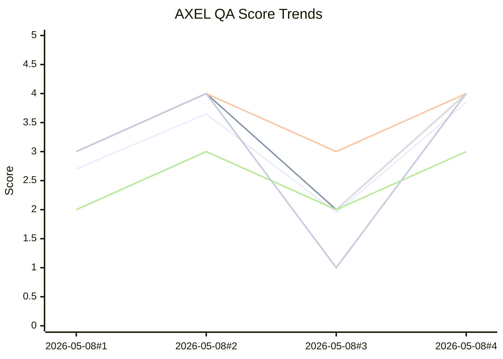

# AXEL QA Analytics

Auto-generated from `AXEL_QA_RUN_LOG.md` by `tools/qa/update_qa_analytics.py`.

- Last generated (UTC): `2026-05-10T16:14:36.609056+00:00`
- Runs parsed: `4`

## Latest snapshot

- Mode: `static`
- Scope: `scenes/Arc_1/1.1_SchoolExterior.gd and scenes/Arc_1/1.1_SchoolExterior.tscn door interaction trigger, key handling, and corridor transition path`
- Trigger: `user request`
- Findings: `blocker=0 major=0 minor=1 nit=1`
- Categories: `STYLE=0 LORE=0 IMMERSION=0 TENSION=1 CLARITY=1 COMBAT=0 ARCH=0 REGRESSION=0 BUG=0 TOOL=0`
- Bugs/problems: `none`
- Bots: `no bot keys`

## Latest deltas vs previous run

- `Total`: `3.85` (`+1.90` vs previous)
- `S`: `4.00` (`+2.00` vs previous)
- `N`: `4.00` (`+1.00` vs previous)
- `I`: `4.00` (`+2.00` vs previous)
- `E`: `3.00` (`+1.00` vs previous)
- `C`: `4.00` (`+3.00` vs previous)
- `R`: `4.00` (`+3.00` vs previous)
- `Bots`: `n/a` (no bot data this run)

## Trend chart (Total + S/N/I/E/C/R + Bots)

Fallback Mermaid view:

- Series order: Total, S, N, I, E, C, R. The dashed `Bots` aggregate (pass=5, fail=0; gaps for skip/missing) appears in the SVG only — Mermaid `xychart-beta` cannot render gaps cleanly so it is omitted from the fallback view.
