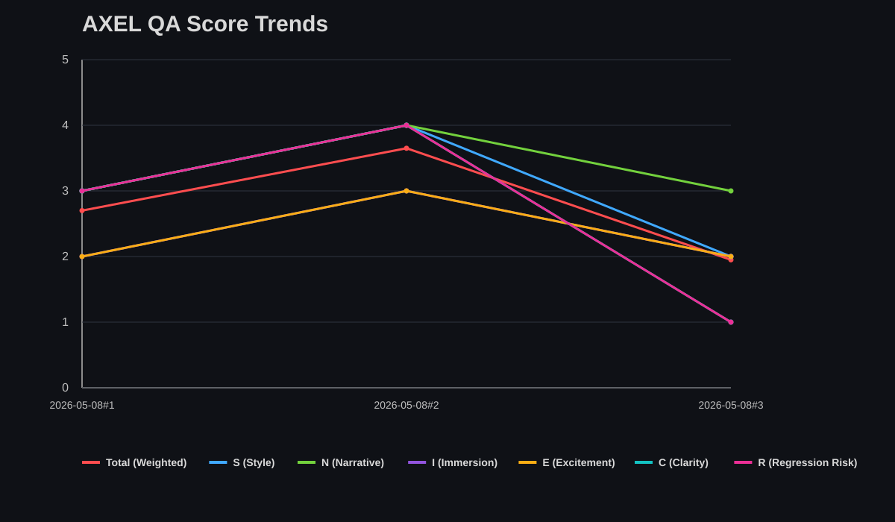
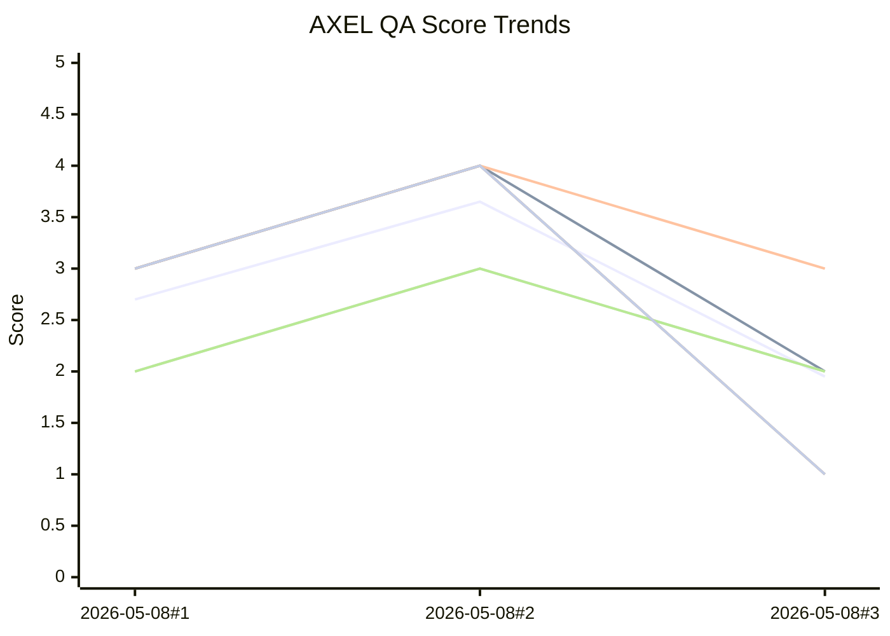

# AXEL QA Analytics

Auto-generated from `AXEL_QA_RUN_LOG.md` by `tools/qa/update_qa_analytics.py`.

- Last generated (UTC): `2026-05-08T16:01:29.834960+00:00`
- Runs parsed: `3`

## Latest snapshot

- Mode: `static`
- Scope: `scenes/Arc_1/1.1_SchoolExterior.tscn placeholder behavior/dialogue plus shared scenes/core/ScenePlaceholder.gd`
- Trigger: `user request`
- Findings: `blocker=1 major=1 minor=2 nit=0`
- Categories: `STYLE=1 LORE=0 IMMERSION=1 TENSION=0 CLARITY=1 COMBAT=0 ARCH=0 REGRESSION=1 BUG=1 TOOL=0`
- Bugs/problems: `Arc 1.1 placeholder has no transition interaction to 1.2_Corridor`

## Latest deltas vs previous run

- `Total`: `1.95` (`-1.70` vs previous)
- `S`: `2.00` (`-2.00` vs previous)
- `N`: `3.00` (`-1.00` vs previous)
- `I`: `2.00` (`-1.00` vs previous)
- `E`: `2.00` (`-1.00` vs previous)
- `C`: `1.00` (`-3.00` vs previous)
- `R`: `1.00` (`-3.00` vs previous)

## Trend chart (Total + S/N/I/E/C/R)

Fallback Mermaid view:

- Series order: Total, S, N, I, E, C, R.
