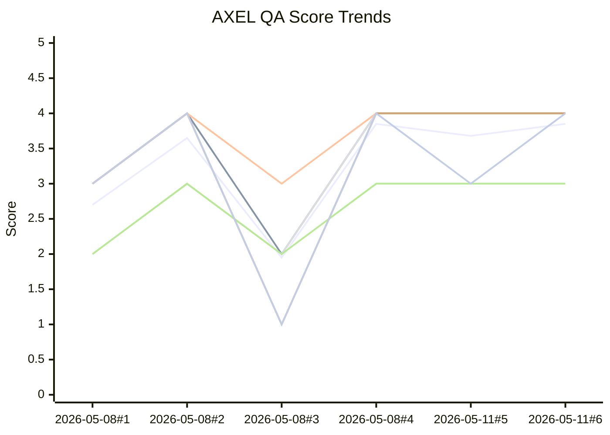

# AXEL QA Analytics

Auto-generated from `AXEL_QA_RUN_LOG.md` by `tools/qa/update_qa_analytics.py`.

- Last generated (UTC): `2026-05-11T14:05:46.993169+00:00`
- Runs parsed: `6`

## Latest snapshot

- Mode: `playtest`
- Scope: `Item system infra (ItemDef, ItemInventory, CombatRoot equip API, dev picker) + C1 implementation + full combined playtest`
- Trigger: `user request`
- Findings: `blocker=0 major=0 minor=2 nit=1`
- Categories: `STYLE=0 LORE=0 IMMERSION=0 TENSION=0 CLARITY=1 COMBAT=2 ARCH=0 REGRESSION=0 BUG=0 TOOL=0`
- Bugs/problems: `C1 classified overpowered (delta_rtp=+0.465, CI [0.121, 0.808]); Pre-existing TileSetAtlasSource coord errors in SchoolExterior tilemap`
- Bots: `bot_arc1_exterior=pass bot_dialogue_loop=pass`
- Item balance audit: `captured`

## Latest deltas vs previous run

- `Total`: `3.85` (`+0.17` vs previous)
- `S`: `4.00` (`+0.00` vs previous)
- `N`: `4.00` (`+0.00` vs previous)
- `I`: `4.00` (`+0.00` vs previous)
- `E`: `3.00` (`+0.00` vs previous)
- `C`: `4.00` (`+0.00` vs previous)
- `R`: `4.00` (`+1.00` vs previous)
- `Bots`: `5.00` (`+0.00` vs previous)

## Trend chart (Total + S/N/I/E/C/R + Bots)

Fallback Mermaid view:

- Series order: Total, S, N, I, E, C, R. The dashed `Bots` aggregate (pass=5, fail=0; gaps for skip/missing) appears in the SVG only — Mermaid `xychart-beta` cannot render gaps cleanly so it is omitted from the fallback view.

## Item Balance Summary

Runs with item data: `1`

- Items tested (latest): `1`
- Overpowered: `C1_ash_reroll_token`
- Underpowered: `none`
- Neutral: `0`
- Insufficient data: `0`

### Latest per-item deltas

| Item | Label | ΔRTP | CI95 | ΔHit Rate | ΔEnc. Success |
|------|-------|------|------|-----------|---------------|
| `C1_ash_reroll_token` | **overpowered** | `+0.4648` | `[+0.1211, +0.8085]` | `+0.0000` | `+0.0167` |
