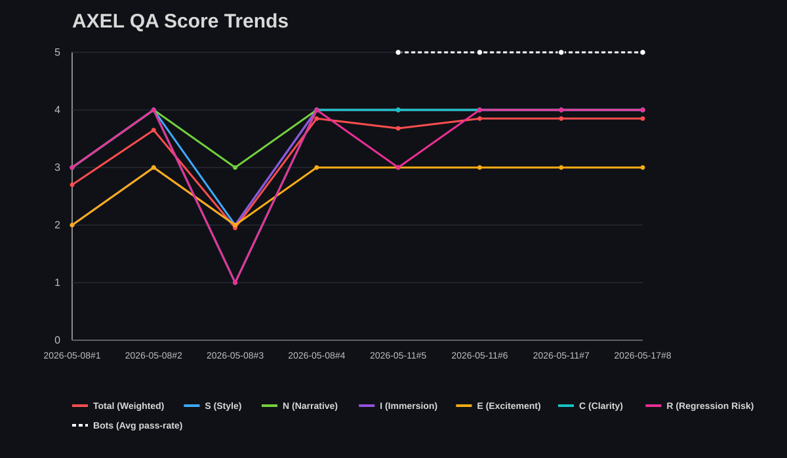

# AXEL QA Analytics

Auto-generated from `AXEL_QA_RUN_LOG.md` by `tools/qa/update_qa_analytics.py`.

- Last generated (UTC): `2026-05-23T14:30:49.945243+00:00`
- Runs parsed: `11`

## Score interpretation

- **Progress (points)** — sum of completed milestone weights (left axis, 0–250+).
- **Scope ceiling** — `checklist_total_weight` for that QA run: the maximum points possible if every milestone in `QA_PROGRESS_CHECKLIST.md` were done. The dashed blue line steps up when you add milestones (e.g. 149 → 200). It is **not** a score — it is the size of the project definition.
- **Quality / Total** — weighted rubric score 0–5 (bold red, right axis).
- **S, N, I, E, C, R** — rubric axis breakdown 0–5 (dashed, right axis).
- **Neither** points nor Quality alone means ship-ready.

## Latest snapshot

- Mode: `playtest`
- Scope: `Default playtest + canon audit`
- Trigger: `user request`
- **Progress:** `48/200 pts (12%) gate=0 cap=1.5 score=1.2`
- **Quality:** `Total=3.10` Band=`C`
- Findings: `blocker=1 major=7 minor=2 nit=0`
- Categories: `STYLE=1 LORE=0 IMMERSION=0 TENSION=0 CLARITY=1 COMBAT=7 ARCH=0 REGRESSION=1 BUG=1 TOOL=0`
- Bugs/problems: `combat_test_scaffold_check duplicate grid`
- Item balance audit: `skip`
- Canon consistency audit: `pass`

## Canon Consistency Audit (latest)

- Findings: blocker=`0` major=`7` minor=`2` nit=`0`

### Top findings

- `major` | `COMBAT` | `combat.grid_duplicate` — CombatRoot has 2x GridUI
## Latest deltas vs previous run

- `ProgressPoints`: `48.00` (n/a previous)
- `ScopeCeiling`: `200.00` (`+0.00` vs previous)
- `Quality`: `3.10` (`-0.47` vs previous)
- `Total`: `3.10` (`-0.47` vs previous)
- `S`: `3.00` (`-1.00` vs previous)
- `N`: `4.00` (`+0.00` vs previous)
- `I`: `3.00` (`+0.00` vs previous)
- `E`: `3.00` (`-1.00` vs previous)
- `C`: `3.00` (`+0.00` vs previous)
- `R`: `2.00` (`-1.00` vs previous)

## Trend chart (project points + quality)

## Run index (chart x-axis)

| Run | Date | Scope |
|-----|------|-------|
| `R1` | `2026-05-08` | validation run for analytics parser and trend ge… |
| `R2` | `2026-05-08` | validation run with playtest command outcomes an… |
| `R3` | `2026-05-08` | scenes/Arc_1/1.1_SchoolExterior.tscn placeholder… |
| `R4` | `2026-05-08` | scenes/Arc_1/1.1_SchoolExterior.gd and scenes/Ar… |
| `R5` | `2026-05-11` | combat baseline full playtest + item balance aud… |
| `R6` | `2026-05-11` | Item system infra (ItemDef, ItemInventory, Comba… |
| `R7` | `2026-05-11` | Full combined run after workflow hygiene changes |
| `R8` | `2026-05-17` | Post-fix QA for combat seed queue, HUD spin cont… |
| `R9` | `2026-05-19` | Post-rescale combat economy; win/loss and wager/… |
| `R10` | `2026-05-19` | symbol_slot.gd retimed win popup; combat_root/co… |
| `R11` | `2026-05-23` | Default playtest + canon audit |


Chart x-axis: `R1`, `R2`, … with `MM-DD` below; full dates and scopes in the run index table.

Fallback Mermaid view:

```mermaid
xychart-beta
  title "AXEL QA — Project points (auto scale)"
  x-axis ["R1", "R2", "R3", "R4", "R5", "R6", "R7", "R8", "R9", "R10", "R11"]
  y-axis "Points" 0 --> 250
  line [null, null, null, null, null, null, null, null, null, null, 48]
  line [200, 200, 200, 200, 200, 200, 200, 200, 200, 200, 200]
```

- SVG: left = project points (0–250+); right = Quality + S/N/I/E/C/R (0–5). Mermaid fallback shows points lines only.

## Item Balance Summary

Runs with item data: `5`

- Items tested (latest): `2`
- Overpowered: `none`
- Underpowered: `none`
- Neutral: `2`
- Insufficient data: `0`

### Latest per-item deltas

| Item | Label | ΔRTP | CI95 | ΔHit Rate | ΔEnc. Success |
|------|-------|------|------|-----------|---------------|
| `C1_ash_reroll_token` | **neutral** | `+0.0058` | `[-0.1570, +0.1686]` | `-0.0430` | `+0.0000` |
| `L3_void_satchel` | **neutral** | `+0.0000` | `[-0.1635, +0.1635]` | `+0.0000` | `+0.0000` |
