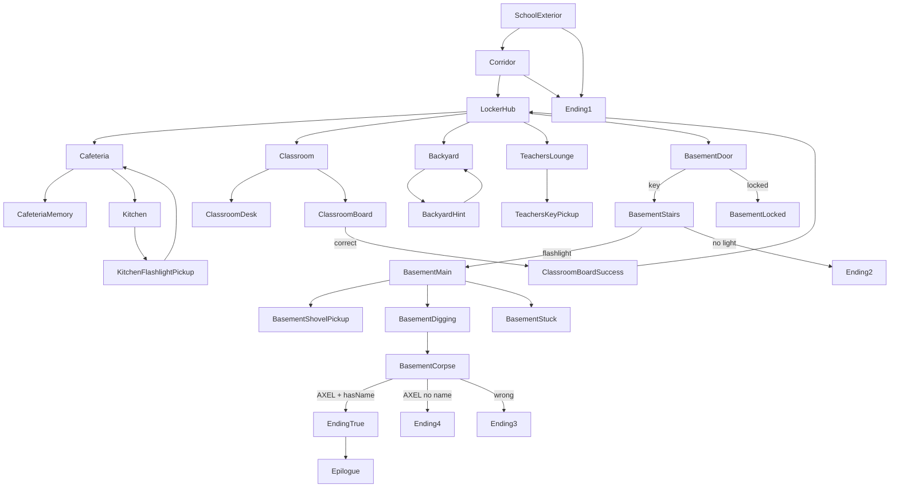

# AXEL - HTML to Godot Scene Blueprint

Source of truth: [AXEL/html/game.html](AXEL/html/game.html) (the `story` object starting at line 150 and the FX logic in `loadScene` below it).

Target location: `AXEL/axel_project/scenes/` (the project currently points at `res://scenes/Main_Menu/0.1_MainMenu.tscn` in [AXEL/axel_project/project.godot](AXEL/axel_project/project.godot)).

## Global conventions for every placeholder scene

Every scene shares the same HUD chrome (status bar + story box + choices grid). Build this once:

- `scenes/ui/HUD.tscn` - `CanvasLayer` with `LocationLabel`, `MemoryCounter` (`x/5`), `InventoryLabel`, home button.
- `scenes/ui/StoryBox.tscn` - `PanelContainer` with `RichTextLabel` (story_text) + `VBoxContainer` for choice buttons. Expose `set_text(text)`, `set_choices(array)`, `glitch(duration)`.
- `scenes/ui/PuzzleInput.tscn` - `LineEdit` + `Button` for the two text puzzles (`loc_board`, `basement_question`).
- `scenes/fx/Scanlines.tscn` - full-screen `ColorRect` + shader mimicking `.scanlines` (lines 20-25 of [AXEL/html/styles_game.css](AXEL/html/styles_game.css)).
- `scenes/fx/SceneShake.gd` + `SceneGlitch.gd` - reusable tweens matching `scene-shake` (0.16s linear x2) and `glitch-text` (1s).
- `autoload/GameState.gd` - singleton holding `inventory`, `memories`, `memory_scenes`, `flags` (mirrors the `gameState` object). Implements `add_memory_once(key)`, `has_item(flag)`, `get_smoking_hint()` (lines 112-134 of game.html).
- `autoload/SceneRouter.gd` - `load_scene(id)` equivalent to JS `loadScene`. Handles the two "logic" nodes (`check_flashlight_logic`, `check_true_ending_logic`) without creating real scenes for them.

Each gameplay scene is a `Node2D` root with `Background` (`Sprite2D` / `TextureRect`), an optional interaction `Area2D`, and an instance of the HUD. Memory scenes are identical but have no interaction areas - just the story box with glitch-in.

Art placeholders: drop `ColorRect` + `Label` with the filename (e.g. `school.png`) until real art exists. Images live under `pictures/` in the HTML build; copy to `axel_project/assets/pictures/` for Godot.

---

## Arc 1 - Intro

### 1.1 `1.1_SchoolExterior.tscn` (HTML id: `start`)
- Location label: (empty)
- Background: `school.png`
- Viewport: `ExplorationViewport` child — `design_viewport = Vector2i(1400, 1400)` (square; matches art aspect). Restores global 1400×900 on exit. Debug: env `AXEL_DEBUG_VIEWPORT_SCALE`.
- **Playtest variant:** `1.1_SchoolExterior_Playtest.tscn` — scene inheritance from base; only override is `skip_intro = true`. Edit the base `.tscn` for colliders/art; F6 the playtest scene for quick iteration without the forced intro. Unlock background via Scene-tree lock icon if repositioning art (`locked_exploration_background.gd` on `Background_1_1`).
- Player leaf fade (legacy): `TreeLine_Bottom_Behind` + `TreeLine_Top_Behind` under `EnvironmentColliders` — `leaf_occlusion_zone.gd` on each (`feather_px`; polygon = child `CollisionPolygon2D`). `1.1_SchoolExterior.gd` → `Player.configure_leaf_occlusion_polygons` → `white_sprite.gdshader` (feathered polygon mask × trunk Y gate + feet anchor). Opaque in front of trunk; fade inside behind zones under canopy. **Editor tuning:** drag polygon points per tree; set `Feather Px` (both zones hand-tuned to `12.0` — preserve unless playtest says otherwise). `ShadowOutline` shares player shader material.
- Dialogue: "You stand before the rotting wooden school building. The sky is grey. You feel a jolt in your chest, your GUILT lies here. You've come to finish what was left undone years ago."
- Choices: `Walk inside` -> `Corridor`, `Turn away` -> `Ending1`
- Animations: slow fade-in from black (1.5s); subtle low-frequency sway on the building sprite; scanlines overlay.
- `onEnter`: full reset of `GameState` (matches lines 159-165).
- Placeholder layout pass (current blockout for `1.1_SchoolExterior.tscn`):
  - Scene read: pathway leading to an abandoned school building.
  - Asset naming in scene:
    - `1.1_Plant_01`
    - `1.1_Plant_02`
    - `1.1_Plant_03`
    - `1.1_Plant_04`
    - `1.1_Path_Texture_01` (large non-tile path shape spanning the approach)
    - `1.1_School_Building_Exterior_01`
    - `1.1_School_Building_Doors_01` (positioned inside/front of exterior footprint)
  - Placement intent:
    - Composition convention: scene reads left-to-right with a high top-down perspective.
    - Path texture runs through the center horizontally, heading toward the right.
    - Plants are distributed on both sides of the path (above and below it on the Y-axis).
    - School exterior sits at the far-right end of the path.
    - Doors are layered in front of the school exterior at the path endpoint.

### 1.2 `1.2_Corridor.tscn` (`scene_2`)
- Location label: `CORRIDOR`
- Viewport: `ExplorationViewport` child — `design_viewport = Vector2i(1920, 1200)` (matches 2400×1500 art aspect; 1:1 cover-fit, no side crop). Restores global 1400×900 on exit. Debug: env `AXEL_DEBUG_VIEWPORT_SCALE`.
- Background: `exports/Drawings/1.2_Corridor.png` on `WalkableWorld/Background` (viewport cover-fit in `1.2_Corridor.gd`, deferred after resize; no push-in tween).
- Player: `PlayerLayer` (layer 100), `corridor_large` profile — scale `3.0`, speed `362`; spawn ~`(73, 271)`.
- Camera: `Camera2D` + `camera_follow_vertical.gd` (same pattern as 1.1 — fixed X, smooth vertical follow on `PlayerLayer/Player`). Manual crop (legacy): `fixed_x = 560`, `limit_top = -15`, `limit_bottom = 730`, `limit_left = 0` — hides void outside cover-fit art; do not change `limit_left` without approval.
- Colliders: `WalkableWorld/EnvironmentColliders` in **texture-pixel space** (`StaticBody2D` at collision center, shape at `(0,0)`); `1.2_Corridor.gd` syncs collider `position`/`scale` with cover-fit background on load (legacy — not `BackgroundCamera`).
- Dialogue: opening line via `TopDialogueOverlay` (rewrite in `AXEL_SCENES_ARC1.md`).
- Choices: `Go to your locker` -> `LockerHub`, `Turn away` -> `Ending1` (not wired in current minimal scene).
- Animations: optional future ambient FX only.

---

## Arc 2 - Hub

### 2.1 `LockerHub.tscn` (`scene_3`)
- Location label: `YOUR LOCKER`
- Background: `hub.png`; on click the background swaps to `map.png` (JS lines 497-503).
- Dialogue: "You are in your sanctuary. There's a picture of the two of you on the locker door. The map shows four circled locations. The basement entrance has been blacked out."
- Choices: Cafeteria / Classroom / Backyard / Teachers' lounge / `ENTER THE BASEMENT` (red, routes to `basement_entry` once unlocked, else `BasementBlockedTemp`).
- Animations: glitch-flash on the memory counter when entered the first time (`addMemoryOnce("scene_3")`); `Area2D` on the locker door -> swaps texture to `map.png`.
- Logic note: the JS `isSceneInteractionLocked` check means in Godot we gray out Kitchen/Backyard/Teachers entries until their prerequisites are met. Easier to implement by making the target scene itself reject entry and bounce back, but keep button styling in `ChoiceButton.gd`.

### 2.2 `BasementBlockedTemp.tscn` (`basement_blocked_temp`)
- Location label: `BASEMENT`
- No background.
- Dialogue: "The basement is sealed off for now. Come back later."
- Choice: `Go back` -> `LockerHub`.
- Animations: none - this is a dialog-only gate shown before the player has satisfied prerequisites.

---

## Arc 3 - Cafeteria

### 3.1 `Cafeteria.tscn` (`loc_cafeteria`)
- Location label: `CAFETERIA`
- Background: `cafeteria.png`
- Dialogue: "Tables are overturned. The air reeks of rancid grease. In the middle of the hall you see a ghostly figure sitting alone at an intact table. The kitchen area is dark."
- Choices: `Approach Your table` -> `CafeteriaMemory`, `Search the kitchen` -> `Kitchen`, `Return to locker` -> `LockerHub`.
- Animations: translucent ghost sprite (floating idle loop, alpha 0.4); `kitchen area` panel rendered darker via masked gradient.

### 3.2 `CafeteriaMemory.tscn` (`loc_cafeteria_memory`) - memory-only, no interaction
- Location label: `CAFETERIA`
- Background: `cafeteria_table.png`
- Dialogue: "You are sitting at the same table. The popular kids invite you over. Your friend whispers, 'Don't go.' You stand up, laugh and shout loud: 'Sorry, I can't deal with your whining.' You leave them alone."
- Choice: `Go back` -> `Cafeteria`.
- `onEnter`: `GameState.add_memory_once("loc_cafeteria_memory")` + glitch flash on the story text (1s) to match `addMemory()`.

### 3.3 `Kitchen.tscn` (`loc_kitchen`)
- Location label: `KITCHEN`
- Background: `kitchen.png` (dark); after pickup it renders `kitchen_no_flash.png` (JS lines 476-482).
- Dialogue: "The kitchen is rotting at the seams. You see the rot pile up in the air. The smell is horrendus."
- Choices: `Turn back` -> `Cafeteria`; plus a hidden click `Area2D` over the counter that loads `action_get_flashlight` when `!hasFlashlight` (JS lines 492-495). Scene is locked (`choice-btn-locked`) until `hasFlashlight` too.
- Animations: slow particle `CPUParticles2D` for "rot in the air"; optional flies buzzing sfx.

### 3.4 `KitchenFlashlightPickup.tscn` (`action_get_flashlight`) - short state screen
- Location label: `KITCHEN`
- Background: `kitchen_no_flash.png`
- Dialogue: "Your hand hits cold metal. You found an industrial flashlight!"
- Choice: `Nice` -> `Cafeteria`.
- `onEnter`: `flags.hasFlashlight = true`, `add_to_inventory("Flashlight")`.
- Animations: brief light-flash tween + UI inventory add ping.

---

## Arc 4 - Backyard

### 4.1 `Backyard.tscn` (`loc_yard`)
- Location label: `BACKYARD`
- Background: `backyard.png`
- Dialogue (state 0): "The corner at the back of the school. The wall has a weird graffiti on it. You still smell the teen rebelry around."
- Choices: `Smoke a cigarette` -> `BackyardHint`, `Return to locker` -> `LockerHub`. Scene is locked until `memoryScenes.loc_yard_memory` is set; the whole background itself is clickable to advance the memory sequence (JS lines 505-542).
- Click sequence (state machine inside this scene):
  1. Glitch-flash story text 250ms -> swap to `loc_yard_memory.text`: "Your friend looks gaunt. 'Just to make sure you don't steal my lighter again I'm going to write my name on it.'" + `add_memory_once("loc_yard_memory")`.
  2. Swap to: `YOU look down. There it is. A lighter with the name "AXEL" written on it.` + set `flags.hasName`, `flags.knowsName`, add `Name` to inventory.
  3. Reload `loc_yard` in normal (unlocked) state.
- Animations: graffiti highlight pulse; quick glitch on text transitions; on step 2, a `Sprite2D` of the lighter fades in at the feet position.

### 4.2 `BackyardHint.tscn` (`loc_yard_hint`)
- Location label: `INTERMISSION`
- Background: `cigarette.png`
- Dialogue: dynamically chosen by `get_smoking_hint()`; one of:
  - "The basement is bound to be dark. I need something to light the way"
  - "I remember their face. But their name escapes me"
  - "The basement is bound to be locked. I better look around for the key."
  - "I should look around more. There's something I'm forgetting."
  - "I'm ready." (when all prerequisites done)
- Choice: `Continue` -> `Backyard`.
- Animations: smoke particle trail rising from cigarette tip; subtle warm tint.

---

## Arc 5 - Teachers' Lounge

### 5.1 `TeachersLounge.tscn` (`loc_teachers`)
- Location label: `TEACHERS' LOUNGE`
- Background: `teacher_key.png` (or `teacher_no_key.png` after pickup - JS lines 478-479).
- Dialogue: "The air is stale. You always wondered what the teachers were doing behind closed doors."
- Choice: `Return to locker` -> `LockerHub`. Locked until `hasKey`. Background itself is clickable to advance memory sequence (JS 544-571).
- Click sequence:
  1. Glitch 250ms, swap text to memory, `add_memory_once("loc_teachers_memory")`.
  2. Load `TeachersKeyPickup`.
- Animations: muted fluorescent flicker; document pages rustling particle.

### 5.2 `TeachersMemory.tscn` (`loc_teachers_memory`) - memory overlay (no own background in HTML)
- Location label: `TEACHERS' LOUNGE`
- Dialogue: "The cop asked, 'When did you last see him?' You answered: 'That day at lunch. I thought they went home.' You lied. You knew exactly where THEY were."
- This plays inside `TeachersLounge` per the click handler, so in Godot implement it as an embedded state, not a separate file (saves a scene). Keep a separate file only if you want a pure memory view.

### 5.3 `TeachersKeyWall.tscn` (`loc_key_wall`) - currently unused in the JS flow
- Retained in HTML but not reachable with current choices. Either omit or reserve for future hook.

### 5.4 `TeachersKeyPickup.tscn` (`action_get_key`)
- Location label: `TEACHERS' LOUNGE`
- Background: `teacher_no_key.png`
- Dialogue: "You take the key. A bit of tape reads: 'BASEMENT'."
- Choice: `Nice` -> `TeachersLounge`.
- `onEnter`: `flags.hasKey = true`, inventory `Key`.
- Animations: key-jingle sfx + inventory add ping.

---

## Arc 6 - Classroom

### 6.1 `Classroom.tscn` (`loc_classroom`)
- Location label: `CLASSROOM`
- Background: `classroom.png`
- Dialogue: "Dust dances in the beams of light. In the back row one desk sits apart from the others. A chalkboard stands at the front."
- Choices: `Inspect the desk` -> `ClassroomDesk`, `Look at the board` -> `ClassroomBoard`, `Return to locker` -> `LockerHub`.
- Animations: dust motes `CPUParticles2D` in a god-ray cone.

### 6.2 `ClassroomDesk.tscn` (`loc_desk`) - scripted animation
- Location label: `CLASSROOM`
- Background starts as `desk_empty.jpg`, story text hidden.
- Animation sequence (JS lines 573-594) played once when `!deskSequencePlayed`:
  1. t=0: blank text.
  2. t=650ms: swap texture to `desk_hand.png`, apply `scene-image-switch` (opacity 0.45) + `scene-shake` (0.16s x2).
  3. t=1000ms: remove shake, swap to `desk.png`.
  4. t=1300ms: reveal final text and call `add_memory_once("loc_desk")`.
- Final dialogue: "This is THEIR desk. You remember. It was a dare."
- Choice: `Close the lid` -> `Classroom`.
- Implementation note: Use an `AnimationPlayer` with three keyframes calling `_swap_bg(path)` and toggling a `ColorRect` overlay for the opacity blend.

### 6.3 `ClassroomBoard.tscn` (`loc_board`) - text puzzle
- Location label: `CLASSROOM`
- Background: `board.png`
- Dialogue: "On the board is code: `if (name == ____) { remember(); }`. Do you know the name?"
- Input: text field, correct answer `AXEL` (case-insensitive, trimmed - mirror `input.value.toUpperCase().trim()`).
- On success: `ClassroomBoardSuccess`. On fail: show "The board doesn't respond." (scene.failText). Retry reloads same scene.
- Choice: `Turn back` -> `Classroom`.
- Animations: typed-letter tick sound; subtle chalk puff when answer entered.

### 6.4 `ClassroomBoardSuccess.tscn` (`loc_board_success`)
- Location label: `CLASSROOM`
- Background: `board.png`
- Dialogue: "At least YOU remember that much."
- Choice: `Take the name` -> `LockerHub`.
- `onEnter`: `flags.hasName = true`, inventory `Name`.
- Animations: brief glow on the missing chalk word.

---

## Arc 7 - Basement

### 7.1 `BasementDoor.tscn` (`basement_entry`)
- Location label: `BASEMENT DOOR`; no background (black).
- Dialogue: "A heavy metal door. The sign reads 'ENTRY FORBIDDEN'."
- Choices: `Unlock with key` -> `BasementStairs` (if `hasKey`); else `Try the handle (Locked)` -> `BasementLocked`; `Go back` -> `LockerHub`.
- Animations: dim spotlight on door sprite; handle jiggle when locked.

### 7.2 `BasementLocked.tscn` (`basement_locked`)
- Location label: `LOCKED`
- Dialogue: "The door won't budge. You need a key."
- Choice: `Go back` -> `LockerHub`.

### 7.3 `BasementStairs.tscn` (`basement_stairs`)
- Location label: `STAIRCASE`
- Dialogue: "The door opens. Before you lie pitch-black stairs. The smell is nauseating. Are you ready to step into the darkness?"
- Choices: `Go down` -> router (`check_flashlight_logic`), `I'm not ready` -> `LockerHub`.
- Router: if `hasFlashlight` go to `BasementMain`, else go to `Ending2`. Implement as `SceneRouter.check_flashlight()` rather than a `.tscn`.
- Animations: slow camera descend, breath sfx, red vignette creeping in.

### 7.4 `BasementMain.tscn` (`basement_main`)
- Location label: `MAIN CHAMBER`; no background - render flashlight cone as a `Light2D` over a dark canvas.
- Dialogue: "The beam hits soft soil. In the corner something metallic glints. There is no going back."
- Choices: `Pick up the shovel` -> `BasementShovelPickup` (if `!hasShovel`); `Dig (Requires shovel)` -> `BasementDigging` (if `hasShovel`); `Turn back` -> `BasementStuck`.
- Animations: flashlight follows cursor; glint particle pulsing on shovel corner.

### 7.5 `BasementShovelPickup.tscn` (`action_get_shovel`)
- Location label: `FOUND`
- Dialogue: "You found a rusty shovel."
- Choice: `Continue` -> `BasementMain`.
- `onEnter`: `flags.hasShovel = true`.

### 7.6 `BasementStuck.tscn` (`basement_stuck`)
- Location label: `NO RETURN`
- Dialogue: "The door is locked behind you. You must face this."
- Choice: `Back` -> `BasementMain`.

### 7.7 `BasementDigging.tscn` (`basement_digging`) - final memory
- Location label: `DIGGING`
- Dialogue: "You strike the shovel into the ground. Thud. Fabric... bone. The final memory surfaces."
- Choice: `FACE THE TRUTH` -> `BasementCorpse`.
- `onEnter`: `add_memory_once("basement_digging")`.
- Animations: three screen shakes timed with "Thud" beats; dirt particles each strike; glitch on text.

### 7.8 `BasementCorpse.tscn` (`basement_question`) - text puzzle
- Location label: `CORPSE`
- Dialogue: "Before you is a mummified body. Its jaw drops open. A voice echoes in your head: 'WHO AM I?'"
- Input: correct answer `AXEL`. Success -> router `check_true_ending_logic`; fail -> `Ending3`.
- Router: if `hasName` -> `EndingTrue`, else `Ending4`.
- Animations: corpse jaw drops via `AnimationPlayer` when scene opens; distant echo sfx.

---

## Arc 8 - Endings

Each ending is a static scene with title, dialogue, and a `Start again` button that returns to `SchoolExterior` (HTML `start`). Use one reusable `Ending.tscn` with exported properties.

### 8.1 `Ending1.tscn` - "Fear wins over curiosity. You walk away. In the nights that follow you have nightmares, but you never learn the truth."
- Animation: slow fade to black + distant nightmare whispers loop.

### 8.2 `Ending2.tscn` - "You step into darkness without light. Your foot slips. You tumble down the stairs and your neck breaks. The shadows consume you."
- Animation: jump-cut screen shakes, then black.

### 8.3 `Ending3.tscn` - "You answer wrong. 'You still don't care!' the voice screams. The basement walls glow red. Fire engulfs you. You are in hell."
- Animation: red tint pulse, fire particle overlay, distorted text.

### 8.4 `Ending4.tscn` - "You whisper 'Axel'. The body goes silent. But then the police burst in. You have no evidence (Name missing) that it was suicide. You are convicted of murder."
- Animation: red/blue siren flash alternating.

### 8.5 `EndingTrue.tscn` - "You whisper 'Axel' and give the name. A spirit leaves the body. He looks at peace. 'This can't hurt me anymore,' he laughs. You are forgiven."
- Animation: white spirit `Sprite2D` drifting upward with additive blend; soft tone chord.
- Choice: `Go to the backyard` -> `Epilogue`.

### 8.6 `Epilogue.tscn`
- Location label: `EPILOGUE`
- Dialogue: "You sit together in the backyard. You and a ghost. You smoke in silence. Smoke rises toward the sky. You are free."
- Choice: `Exit` -> `SchoolExterior` (reset).
- Animation: looping smoke particles rising; two figures silhouetted (one translucent).

---

## Scene transition map

